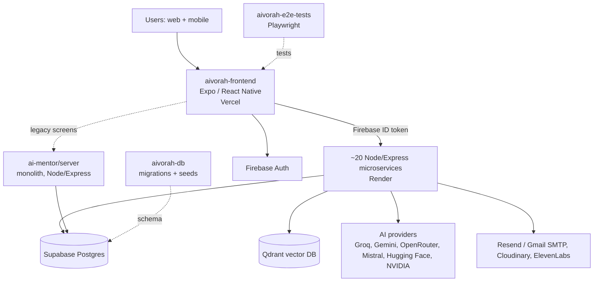

# System overview

_Last verified: 2026-11-03_

## What Aivorah is

An AI learning platform for schools. One app (web + mobile) with five personas:

| Persona | Main areas |
|---|---|
| Student | Dashboard, Learning Paths (Learn / Listen / Practice), Assignments, Challenges, AI Coach, Schedule, Attendance, Bedtime Stories, World & You, Daily Habits, Leaderboard |
| Parent | Child progress, AI progress report, Parental Controls, Schedule, Attendance, Messages |
| Teacher | Dashboard, Students, Assignments, Learning Path editor, Schedule, Attendance, Messages, Announcements, Student Progress |
| School Admin | Students / Parents / Teachers, Grades & Sections, Bulk Import, Timetable & Resources |
| Aivorah Admin (platform) | Platform Overview, Users, Map to Teacher, Bulk Import, LLM Usage |

## Architecture

- **Full diagram** with every service and what it uses: [architecture/ARCHITECTURE.md](architecture/ARCHITECTURE.md).
- **Frontend** calls each microservice directly; each service has its own URL file in `aivorah-frontend/src/config/*ServerUrl.ts`.
- **Auth**: Firebase Auth on the client; services verify the Firebase ID token (`FIREBASE_SERVICE_ACCOUNT_B64`). Role/onboarding comes from `aivorah-auth-service` `/user/sync`.
- **Data**: Supabase Postgres, accessed by services with the service-role key. Schema lives in `aivorah-db`.
- **Monolith** (`ai-mentor/server`): original backend. Features are being moved out one by one. Rule: never add new dependencies on it.

## Environments

| Env | Frontend | Backend | Database |
|---|---|---|---|
| Live / testing (what users use today) | Vercel production (from `master`) | Render (auto-deploy from `main`/`master` on merge) | Supabase |
| PR previews | Vercel preview per PR | — (previews call live Render services) | same |
| Local | `npm run web` | `npm run dev` per service | Supabase Dev |

Supabase projects: **Dev** `evlqkcozespsfrnuhevf`, **Test** `xmwzifxlpmgsrxgxsgan`, **Prod** `jwlepxmclbkrmfzrumch`. Which project each Render service points at is set by its `SUPABASE_URL` env var on Render — confirm in the Render dashboard before any DB change.

> A separate "real production" (GCP + dedicated DB) is planned but **does not exist yet**. Today's Render + Supabase setup is the live environment.

## Ways of working

- **Branches**: feature branch → PR → merge to `master`/`main` → auto-deploy. No direct pushes.
- **Tests**: frontend tests sit next to the feature (`__tests__/unit`, `__tests__/integration`); services use `tests/`. E2E lives only in `aivorah-e2e-tests`.
- **CI**: CircleCI `build_and_test` (lint, tests, build), then `trigger-e2e` runs the E2E smoke suite against the Vercel preview. GitLab (free tier) is available as a fallback runner. Run the same checks locally before every PR.
- **Code layout (frontend)**: `src/screens/<persona>/<feature>/{Screen.tsx, components/, hooks/, services/, utils/, types.ts, __tests__/}`.

## More detail

- [repositories.md](repositories.md) — every repo, what it does, where it deploys
- [architecture/](architecture/) — feature → service map, notifications, Qdrant collections
- [../03-runbooks/](../03-runbooks/) — deploy, migrations, key rotation, service down
